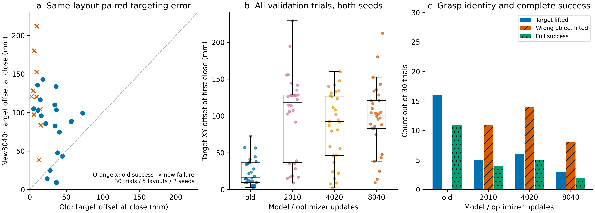
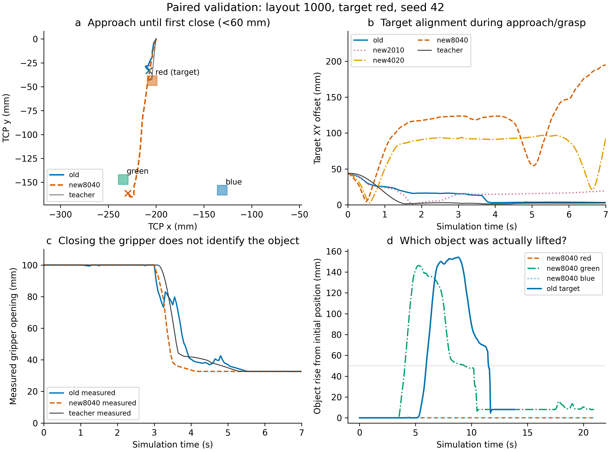
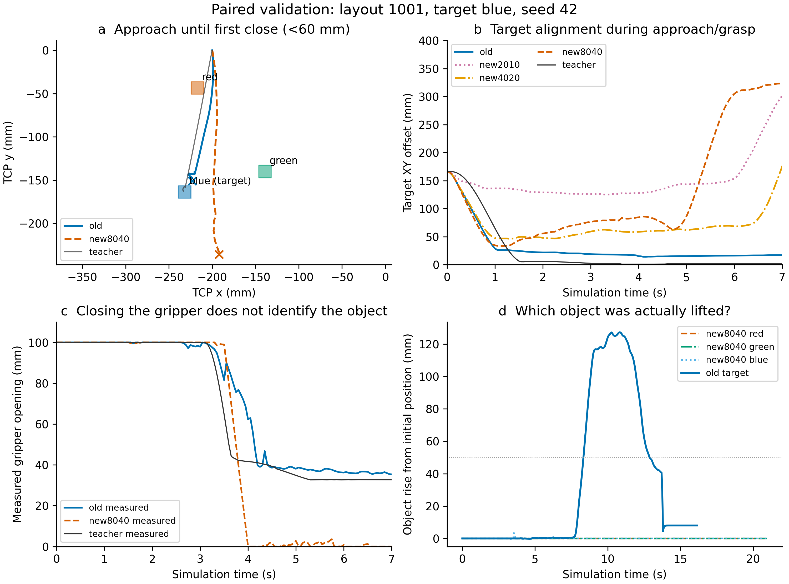
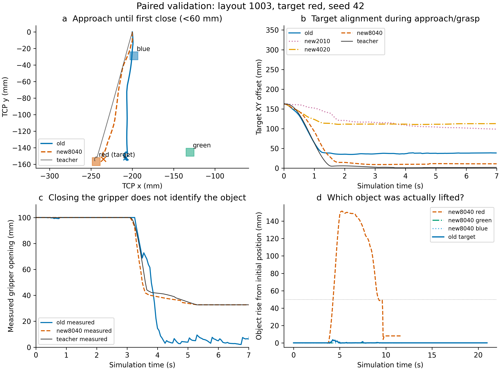
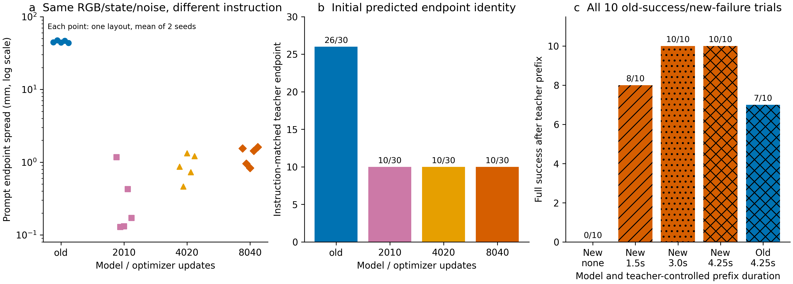

# π0 120 条示教训练为何退化：接近、对准和抓取分析

2026-11-01。结论基于保存的完整轨迹和本轮冻结模型诊断；本轮优化器更新为 0，未使用独立测试集。

**主要退化发生在自主选择接近目标的阶段。新模型在初始状态下对颜色指令的动作响应很弱，常常接近错误物体或偏离所有物体；一旦教师把它带到正确目标附近，后续下降、抓取和放置大多可以完成。** 这解释了为什么训练 loss 降低，却没有带来完整任务成功率提高。

这次 120 条训练从官方 `pi0_base` 独立初始化，没有接续旧六示教模型。旧模型训练了五轮起点，新模型目前只有一轮，而且使用不同的学习率时间轴。现有比较同时改变了数据覆盖、每个起点的重复次数、接触版本和归一化资产，不能将结果解释为“增加到 120 条本身导致性能下降”。

详细机器可读证据和全部图见 [分析结果目录](../results/piper-color-v1/pi0-120-regression-diagnosis-20261101)。下一步实验见 [修复计划](PI0_120_REGRESSION_NEXT_PLAN_20261101.md)。

## 1. 比较范围与方法

主比较使用相同 v2 物理环境中的旧六示教检查点 2010、新 120 条检查点 2010/4020/8040。已有 156 次完整评测均保留。本轮分析其中 30 个配对验证试验：5 个布局 × 3 种目标颜色 × 2 个评测种子，初始物体位置逐项核对一致。颜色和种子共享布局，以下是分组描述，不把 30 次试验当作 30 个独立布局，也不作显著性声明。

闭爪事件定义为实际执行的开口命令第一次小于 0.06 m，低位接近定义为 TCP 首次低于 0.06 m。目标偏差使用当时 TCP 与指令目标的水平距离；“最近物体”是几何诊断，不单独视为已经抓住。抬升使用物体中心相对初始位置升高超过 0.05 m。完整成功沿用原来的正确目标入盒、无错误目标入盒、松爪、干扰物位移和关节约束，持续两秒。

另外完成：21 项教师参考的精确命令回放（6 项现有训练参考、15 项新生成的验证诊断参考），四个检查点共 2,352 次固定教师观测查询，168 次仅改变提示词的查询，以及 40 次教师前缀介入。验证教师仅用于诊断，未写入训练集、归一化或采样顺序。

## 2. 先接近错了，再准确执行错误动作链

| 同环境验证，两个种子合计 | 旧六示教 2010 | 新 2010 | 新 4020 | 新 8040 |
|---|---:|---:|---:|---:|
| 完整成功 | 11/30 | 4/30 | 5/30 | 2/30 |
| 闭爪时最近物体是指令目标 | 27/30 | 10/30 | 10/30 | 8/30 |
| 指令目标抬升 >5 cm | 16/30 | 5/30 | 6/30 | 3/30 |
| 非目标物体抬升 >5 cm | 0/30 | 11/30 | 14/30 | 8/30 |
| 闭爪时目标水平偏差中位数 | 16.73 mm | 118.57 mm | 92.11 mm | 100.99 mm |
| 闭爪时最近物体偏差中位数 | 16.73 mm | 22.57 mm | 22.39 mm | 38.51 mm |
| 闭爪时姿态偏差中位数 | 1.49° | 4.50° | 1.59° | 1.62° |
| 实际命令与下一反馈关节 MAE 中位数 | 0.01187 rad | 0.01001 rad | 0.01119 rad | 0.01126 rad |

10 个旧模型成功的验证试验在新 8040 上变成失败，只有 1 个旧失败试验变成成功。位置误差从厘米级变成约 10 cm，而 8040 的姿态和关节跟踪误差接近旧模型。主要差异因此指向“命令让机械臂去哪里”，而非执行器普遍跟踪失效。

左图逐项配对旧/新闭爪偏差，橙色叉号为旧成功→新失败；中图显示全部试验点，箱体为四分位区间；右图为观测次数，没有独立重复或误差条含义。

## 3. 三条具体轨迹说明了什么

### 布局 1000，抓红块，seed 42：新模型实际抬升了绿块

旧模型在 1.5 s 时已接近红块，继续下降并在闭爪时将目标水平偏差收敛到 9.23 mm，随后成功完成任务。新 8040 则继续向桌面另一排移动；3.0 s 时 TCP 约为 (-0.2263,-0.1653,0.0253) m，红块仍在 (-0.2042,-0.0437,0.0174) m。开始闭爪时偏差为 120.52 mm，最近的是绿块。其后夹爪反馈维持约 33 mm，绿块升高约 15 cm，而红块保持在桌面。

这里不能将“夹爪闭合并抬起一个物体”当作正确抓取；错误从接近方向已出现。

### 布局 1001，抓蓝块，seed 42：沿大致方向移动，却越过目标

旧模型闭爪偏差为 14.97 mm，随后完成蓝块任务。新 8040 仍把蓝块视为几何上最近的物体，但 TCP 在接近过程中偏出物体位置，闭爪时已相距 83.51 mm。夹爪随后基本完全闭合，三个物体都没有形成有效抬升。此例属于接近/对准偏差，不能全部归为“选错颜色”。

### 布局 1003，抓红块，seed 42：保留新模型成功的反例

这是旧失败→新成功的那一项。新 8040 的前段路径更接近教师，能够到达红块、闭爪、抬升和放置。它说明新模型保留了完成整条动作链的能力，不能把全部退化解释为夹爪接口、动力学或模型加载失效。

## 4. 固定图像、状态和噪声，只改颜色指令

每个验证布局固定一份真实初始 RGB 和反馈状态，并为红/绿/蓝三次查询重置到同一个采样噪声；只替换语言指令。用预测动作块第 10 个关节目标的正运动学末端位置衡量响应，同时比较它最接近哪一个颜色指令对应的教师动作块末端。该指标是初始动作诊断，不是闭环成功率。

| 诊断 | 旧六示教 2010 | 新 2010 | 新 4020 | 新 8040 |
|---|---:|---:|---:|---:|
| 更换颜色指令后的末端位置差，中位数 | 44.05 mm | 0.18 mm | 0.81 mm | 1.34 mm |
| 与相应颜色教师末端匹配 | 26/30 | 10/30 | 10/30 | 10/30 |
| 三种指令均选择同一个教师末端的组数 | 0/10 | 10/10 | 10/10 | 10/10 |

每组对应一个布局和一个固定噪声。新模型三种指令的预测虽非完全相同，但差异不足以改变目标方向；10/30 的匹配来自每组三个指令均选同一个目标，其中只有一个指令碰巧匹配。实际训练变换后的 120 个初始样本保留了三种不同的颜色 token 序列，因此没有发现提示词在数据管道中被统一、丢弃或截断的错误。

这个实验定位到的是初始观测下语言条件与空间动作之间的弱联系，尚不能分别归因于语言理解、视觉颜色识别或二者的融合层。

## 5. 给到正确示教状态时，新模型的抓取预测并不差

对每个检查点使用相同的 21 项教师参考，在 14 个固定时刻、两个种子下查询真实输入。下表仅统计 15 项验证参考，使用预测前 5 个动作与教师前 5 个动作的平均误差，再取对应查询的中位数。

| 阶段 | 旧模型 TCP 水平误差 | 新 8040 TCP 水平误差 | 旧模型开口误差 | 新 8040 开口误差 |
|---|---:|---:|---:|---:|
| 接近 | 7.97 mm | 10.08 mm | 1.42 mm | 2.00 mm |
| 下降 | 2.53 mm | 2.25 mm | 1.34 mm | 2.04 mm |
| 抓取 | 1.26 mm | 1.12 mm | 7.47 mm | 2.41 mm |
| 抬升 | 2.69 mm | 1.71 mm | 2.45 mm | 0.97 mm |
| 搬运 | 5.83 mm | 3.35 mm | 0.76 mm | 1.64 mm |

在正确下降、抓取和抬升状态上，新模型的预测可与旧模型相当，部分更好。问题是自主执行时往往到不了这些正确状态。示教中较后时刻的关节状态已经包含了机械臂正在朝哪里移动的信息；依赖这种状态信息推进动作链，可以降低大部分示教起点上的误差，却不保证最初能依据颜色指令选对目标。这与当前证据一致，但没有通过独立状态/视觉消融确定各输入的精确贡献。

## 6. 教师只修正前段，后续能否恢复？

对全部 10 个旧成功→新失败的验证试验作前缀介入，不挑选其中容易的子集。教师执行精确保存的实际命令，然后交给冻结模型；采样 RNG 按原重规划次数推进。前缀状态与教师记录的最大差为 0。物理参数、成功判据、剩余时间上限均不变。

| 条件，同一组 10 个试验 | 完整任务成功 |
|---|---:|
| 新 8040 自主执行 | 0/10 |
| 教师前 30 步，即 1.5 s，接近结束后交给新 8040 | **8/10** |
| 教师前 60 步，即 3.0 s，下降末段交给新 8040 | **10/10** |
| 教师前 85 步，即 4.25 s，抓取后抬升初期交给新 8040 | **10/10** |
| 同样前 85 步后交给旧模型 | 7/10 |

最初 1.5 s 的纠正已恢复八项，接管至下降末段后恢复全部十项，说明前段状态偏离对这些退化试验有直接影响。旧模型的前缀对照为 7/10，也说明教师前缀本身不会自动保证完成。以上属于选定退化集合上的诊断介入，不写回自主验证成功率，也不等同于训练后获得了恢复能力。

## 7. 为什么 loss 下降仍会退化

旧六示教为 1,608 个起点、2,010 次更新、batch 4，即每个起点五次；新 120 条为 32,160 个起点、8,040 次更新，即每个起点一次。新轮的数据量是 20 倍，更新量是 4 倍。它也没有继承旧六示教已学到的条件动作能力。

旧模型的 cosine decay 到 2,010 次结束，末学习率约 3.00e-6；新模型固定到 24,120，8,040 次时仍为 2.3353e-5，约为前者 7.78 倍。因此不能把两个检查点都视作在各自数据上充分收敛后的结果。

与此同时，新轮从 4,020 到 8,040 的验证成绩由 5/30 降至 2/30，初始教师末端匹配仍为 10/30，故“再多跑就一定恢复”也没有依据。曝光次数不足、较高学习率下的优化路径、数据覆盖增加后对状态信息的依赖，仍需受控训练分开验证。

训练 loss 的前/后 500 次均值从 0.08294 降为 0.01254。源码中它是 flow-matching 速度误差，汇总动作块和 32 个动作维度；实际 Piper 动作为 7 维，其余 25 维为动作补零后的建模维度。它不是初始颜色选择准确率，也没有单独保证接近阶段被学好。均匀采样中接近阶段只占 30/268，即 11.19% 的起点；多数样本已处于教师选定了正确目标之后的状态。没有记录逐维损失，因此本报告不将总体下降强行归因于某几个维度。

## 8. 已核查的替代解释与证据边界

- 120 条教师均完整成功；本轮 21 项参考回放均成功，精确执行命令的反馈重放误差为 0。任务在冻结 v2 中可执行。
- 120 条数据的归档摘要、目标/指令、实际命令、展开数组和时间戳均通过检查；三种颜色各 40 条，空间槽位分布没有单一颜色占据单一固定位置。
- 8,040 次日志的实际样本索引与保存排列逐项一致，32,160 个起点各使用一次。旧排列则各使用五次。原先的 2,010/4,020 恢复校验也保留完整优化器计数和配置校验。
- 两轮使用同一模型、batch、horizon、动作含义、优化器和冻结配置。该配置的实际可训练参数约 4.68 亿，并非只训练少量适配器；但它在两轮之间没有突然改变。
- 动作归一化的标准差除接近固定的第 4 关节外，变化约 0–1.53%；夹爪动作统计完全相同。第 4 关节标准差比值为 0.8216。没有发现错误归一化文件或单位混用，但归一化分布变化仍是联合改变的一部分。
- 原六项教师在 v1/v2 的接近、下降和抓取命令几乎相同，最大分阶段关节 MAE 低于 4.2e-13 rad，抬升阶段开始出现约 0.002 rad 量级变化。因此早期命令监督没有被接触修改整体替换为另一种动作定义。
- 同布局独立渲染有少量 1 灰度级像素差异。首轮诊断的严格像素相等断言因此中断，失败记录已保留。修正后的提示词对照直接复用同一份图像数组、状态和噪声，无需假定两次渲染逐位相等。

**行为层面的主要瓶颈已经有直接证据：初始指令条件不足，导致错误接近和对准。训练层面的唯一根因尚未被单变量实验隔离。** 下一步应优先保护或恢复这种初始条件能力，再考虑掉落恢复数据或继续延长整轮训练。

## 9. 可复现材料

结果目录包含逐任务 CSV/JSON、输入 SHA256、全部固定观测和提示词置换结果、前缀介入逐任务记录、数据及真实模型输入检查、PNG/SVG/PDF 图和失败尝试历史。原始 NPZ 的 Release 位置、大小和 SHA256 见结果目录的 `raw_artifact_release.json`；大模型权重和视频仍保留在 D57。

主要脚本为 `analyze_pi0_120_regression.py`、`audit_pi0_regression_data.py`、`audit_pi0_model_inputs.py`、`probe_pi0_120_regression.py`、`summarize_pi0_regression.py` 和 `plot_pi0_120_regression.py`。主证据输入提交为 `c873e854130279d0c5705973a4ce4b43921448a7`；诊断源代码随各阶段提交保留。
