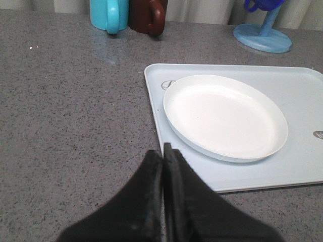

# RoboMIND 可用性复核与首轮实机数据路线

日期：2026-11-23  
项目基线：`kaiwen123-yang/-0--0.5@72ad763699502defed9d39d51bd22a56ea2ce2e8`  
适用配置：Piper H、单腕 DC1 `CC16762023M`、唯一有效图像槽 `left_wrist_0_rgb`、π0 / π0.5 全参微调。

## 1. 本轮决策

**首轮实机训练与测试采用本地任务示范。RoboMIND 保留为后续公开数据适配与对比实验的来源。**

本轮已经找到有真实动作、值得利用的公开数据和单臂子任务候选，但尚未得到一个对本机验收完成的训练集。继续完成源机械臂识别、有效动作流筛选、子任务切分、夹爪与关节映射，会形成一个独立的数据适配项目。用户已明确允许“公开数据能用就用，不合适就采本地示范”，因此当前工程主线转为本地采集，不再为保持零本地示范而无限延长公开数据筛选。

这个选择针对**当前单腕 Piper H 抓放任务的最快可靠推进路径**。本报告没有证明 RoboMIND 全库不适用，也不否定其训练策略或跨场景迁移的价值。完整机器可读结论见 [深查记录](../results/pi-readiness/20261123/robomind_deep_review.json)；原有项目代码与数据审查见 [项目数据审查](../results/pi-readiness/20261123/data_review.json)。

## 2. 实际查验范围：既有 5 条，加本轮 3 条

旧五条的数值与抽帧来自仓库已有真实检查记录，本轮重新核对了记录和适配代码。新增三条从官方 ModelScope HDF5 通过 HTTP Range 读取完整相关关节、夹爪数值与选定相机帧，并检查前视和腕部图像；没有下载全部原始 HDF5，也没有看完整库或逐帧审阅每条完整视频。因此，下表是具体样本结论，不能换算为全库合格率。旧样本来源、固定 revision 和原始路径见 [既有 sources.json][S1]。

| 批次 | 任务与 episode | 源行数 | 本轮可支持的判断 |
| --- | --- | ---: | --- |
| 既有 | `place_milk_next_to_cup / 0611_144656` | 2,658 | 左右两臂均有数值运动；现有抽样没有完成可直接裁成独立单臂任务的验收。 |
| 既有 | `place_pomegranate_in_white_plate / 2024_12_12-10_29_11-173637122753700320.00` | 706 | instruction 为占位内容；夹爪字段达到约 5.43，明显不能与其他约 0.07 量级批次直接混用一种开口换算。 |
| 既有 | `put_scissors_into_bucket / 0411_153031` | 1,893 | 左右两臂均有数值运动；需要任务依赖与夹爪定义复核。 |
| 既有 | `close_fridge_door / 0306_204419` | 2,243 | 已导出右腕读取示例；右臂移动、夹爪近似不变，不能用它单独覆盖完整抓取—释放学习。 |
| 既有 | `write_number_0_on_whiteboard / 0417_160949` | 5,688 | instruction 明确包含左臂取笔、交给右臂书写，不能直接把整条当单臂示范。 |
| 新增 | `place_circuit_board_on_tray / 0623_131736` | 2,984 | 实际腕图确认左臂向右臂交接电路板；整条任务依赖双臂。 |
| 新增 | `put_pen_and_scissors_into_bin / 0415_102035` | 2,947 | 左臂先放笔，右臂随后放剪刀；左臂放笔阶段是正面的独立子任务候选。 |
| 新增 | `place_utensils_into_plate / 0617_144408` | 2,883 | 左腕图像显示左臂搬白盘，但左侧所有关节、夹爪数值为零；左侧数值流失效。白盘到位后的右臂餐具段可保留为后续候选。 |

新增三条固定源 revision 分别为 `09e542af4b7a2f1bf75e89a9eb12ca4297a746c1`、`8c8da260725e5293ccbe72a06f6a7657047d21b0`、`f132a6a3a4af090d8f97b2c440b787aaebaeb66e`。原始 dataset、路径和读取结构保存在各自 manifest 中：

- [电路板原始结构与数值清单](../results/pi-readiness/20261123/robomind_visual/place_circuit_board_on_tray/0623_131736/manifest.json)
- [笔与剪刀原始结构与数值清单](../results/pi-readiness/20261123/robomind_visual/put_pen_and_scissors_into_bin/0415_102035/manifest.json)
- [餐具原始结构与数值清单](../results/pi-readiness/20261123/robomind_visual/place_utensils_into_plate/0617_144408/manifest.json)

本轮新增三条共成功解码 **66 张官方 HDF5 原始 JPEG**（电路板 23、餐具 22、笔剪刀 21），另生成 9 张关键帧汇总图。已验证并保留的唯一源字节范围合计 10,326,467 bytes（约 9.848 MiB），不是包含重试或中断的累计 HTTP 流量。详见 [提取汇总](../results/pi-readiness/20261123/robomind_visual/extraction_summary.json) 和 [视觉审查](../results/pi-readiness/20261123/robomind_visual/robomind_visual_review.json)。此处清单均为检查用途，`training_eligible=false`，并未生成公共训练集。

## 3. 新样本最重要的发现

### 3.1 餐具：恒零反馈不能证明另一条手臂没参与

餐具轨迹的左侧 master、puppet 六轴与夹爪都为零。仅看这些数值，容易把它当成纯右臂任务；前视抽帧也容易漏掉画面边缘的左臂过程。进一步检查左腕图像后，能看到左夹爪抓住并搬运白盘。**物体和左夹爪实际运动，与恒零数值直接矛盾，因此这条左侧监督流无效。**

右侧仍有有效运动信息。对 2,883 行原始数值的检查显示：六轴 master/puppet 位置变化具有较强正相关，最佳位置相关滞后为 8–12 个源行；按整段平均频率估计，约为 80–121 ms。右侧夹爪 master 范围为 `−0.00742…0.05033`，puppet 范围为 `−0.00028…0.04956`，均为原始数值，不能仅凭量级就宣布已完成本机开口换算。详见 [右臂数值比较](../results/pi-readiness/20261123/utensils_stream_comparison.json)。

目标与实测状态有滞后、跟踪误差是正常可能发生的现象。这些统计支持“存在真实操作流”，不构成拒绝训练的独立理由，也不能被直接拿来拟合本机零位或补偿系数。

后续可筛选**白盘已经放好之后，右臂放置叉、刀、勺的完整阶段**。必须保留完整的接近、抓取、转移和释放，明确起止边界、重写任务文字，并将准备好的盘子和托盘作为初始场景条件。整条原始任务目前不作为独立单臂示范使用。

### 3.2 电路板：直接交接，需要另一臂

电路板的前视和腕图显示左右夹爪围绕同一块电路板执行交接。这与“切掉一半关节就能变成单臂示范”的假设不符。完整任务的状态变化依赖另一臂提供物体，当前不纳入本机首轮单臂任务数据。

证据：[电路板前视抽帧](../results/pi-readiness/20261123/robomind_visual/place_circuit_board_on_tray/0623_131736/front_contact.jpg)、[左腕第 745 帧：交接](../results/pi-readiness/20261123/robomind_visual/place_circuit_board_on_tray/0623_131736/left_00745.jpg)、[左腕第 1,118 帧：另一臂放板](../results/pi-readiness/20261123/robomind_visual/place_circuit_board_on_tray/0623_131736/left_01118.jpg)。

### 3.3 笔与剪刀：保留有价值的左臂子任务

这一条的原始 instruction 指定左臂放笔、右臂放剪刀。实际前视与左腕图像显示两阶段先后执行，左臂放笔过程具有可进一步提取为单臂示范的价值。后续应只截取完整左臂放笔阶段，核实其对应数值和场景条件，不能把后续右臂动作拼成左臂标签。

证据：[前视抽帧](../results/pi-readiness/20261123/robomind_visual/put_pen_and_scissors_into_bin/0415_102035/front_contact.jpg)、[左腕抽帧](../results/pi-readiness/20261123/robomind_visual/put_pen_and_scissors_into_bin/0415_102035/left_contact.jpg)。这也是本轮“公开数据中存在有用候选”的正面证据。

## 4. 时间、动作与夹爪：哪些问题能够处理

### 已有字段依据，但要限定适用版本

官方 RoboMIND V1 的 [配置文件][S2] 指定 `qpos_arm_key=puppet`、`action_arm_key=master`；官方 [单位说明][S3] 指出 joint_position 的关节角以 rad 表示。这些是一手依据，不能把所有字段都泛称为“完全不知道含义”。但 V2 采用了 `*_position_align/data` 等不同结构，且具体来源可能不同；V1 的规定不能自动证明每个 V2 批次都与本机控制契约完全相同。

### 秒级时间戳允许明确标注的近似重采样

整数秒时间戳会丢失逐帧时刻精度，但不会自动使轨迹失去训练价值。[RynnVLA-Latent 的实际代码][S4] 对 RoboMIND HDF5 使用 `(N−1)/(t_last−t_first)` 估计整段平均频率，并明确承认整数时间戳带来的量化误差。该代码用于时间跨度与 latent stride 估计，不能证明恢复了曝光同步。

若以后使用这种来源，可在转换器中建立显式的近似均匀时间轴，再一致地选择 20 Hz 网格上的图像、状态和动作源行；保留原始时间戳、源行号、估计频率和近似说明。不能将每一条源行直接当成一条新的 20 Hz 样本，也不能把人工生成的纳秒数字标成实测曝光时间。

### OneWorld 处理版提供了可核查的转换信息

本轮直接通过 HTTP Range 读取了 [OneWorld 固定版本][S5] 的一个 episode metadata，未下载 4 GB 分片。该样本为 `open_pot_and_put_corn_with_arms / 0429_160649`，原始任务明确要求左臂开锅、右臂放玉米。

其 metadata 记录了 **1,757 个源帧、`source_fps_measured=103.29`、输出 511 帧及 30 Hz**，并保留 `0,3,7,10,14,…,1756` 的源帧索引。这足以说明输出 30 Hz 经历了抽样转换；元数据中的输出 fps 不能被当成原始硬件频率证明。该样本还明确写出夹爪源范围约 `0…0.07`，随后除以 `0.07`，以及 state 来自 puppet、action 来自原 master、没有额外时间平移。原文保存在 [实际获取的 metadata](../results/pi-readiness/20261123/oneworld_first_raw_metadata.json)。

这些信息让转换可以追溯，但“0 表示关、1 表示开”仍不足以证明任意来源都已经换算成本机的总开口米。不同批次不能共享一个凭猜测得到的物理比例；对简单开合任务可以设计明确的语义重映射，但应记录为一次有意的适配。

OneWorld 的 [EEF reader][S6] 还明确区分 `command` 和 `next_state`：后者使用下一保留帧的达到状态，并屏蔽末帧，属于派生目标。项目以后可以研究这种监督方案，但不能悄悄把它替代成当前约定的“实际提交的绝对目标”。其 [模型记录][S7] 使用名义 URDF 从关节做 FK，也明确不把无效的 AgileX 原生 EEF 字段当真值。当前项目采用关节动作，因此坏 EEF 字段本身不是整条关节数据必然不可用的理由。

## 5. 本轮未完成的适配工作

| 项目 | 本轮状态 | 对当前决策的意义 |
| --- | --- | --- |
| 整数时间戳、不同帧率 | 可以显式近似与重采样，保留来源和假设 | 不单独作为否决训练的门槛。 |
| 原生 EEF 字段不可靠 | 可弃用；必要时用已核实模型做名义 FK | 当前关节动作路线不必依赖它。 |
| 源机械臂型号与本机对应 | 新样本腕图不足以可靠确认 Piper / ARX5，尚缺批次证据 | 不能凭 `AgileX` 名字直接下发源关节目标。公开处理者也明确区分这两类来源。[公开卡][S8] |
| master 到 follower 的下发映射 | 字段意图和相关运动已有证据，具体批次的转换仍未核实 | 不能把统计拟合当作物理标定；也不因正常跟踪误差而宣布不兼容。 |
| 夹爪总开口、零点和比例 | 发现批次量级差异、主从闭合偏移；尚无覆盖所选源批次的本机换算 | 需要明确物理定义或有意的语义适配。 |
| 单臂任务及单腕完整观察 | 找到候选子任务，也确认交接、失效流和另一臂准备场景 | 还需完整分段与配对验收，当前不能把整条轨迹直接裁半用于训练。 |
| 源腕相机与 DC1 视角 | 源样本为 D435i 系列；安装、视野和场景均与本机不同 | 手眼标定不会自动消除视觉分布差异，零本地迁移效果需要实验验证。 |

继续解决上表未完成部分是合理的后续研究，但不再作为本轮完成实际测试的前置条件。

## 6. 下一步与公开数据的保留方式

本轮先使用本地已有机械臂、夹爪、单腕 DC1 和唯一动作发送端，完成一个简单、可复位的抓放任务采集链路：同时保存未叠字 RGB、六轴加总开口的实测状态、实际提交的目标、时钟信息、任务起止和成功结果。先验证少量完整 pilot，再扩大成功示范规模。静止观测、标定姿态以及只有反馈没有动作标签的记录不充当动作示范。

一条本地 pilot 用来验收数据和控制链路，不能单独代表足够训练数据。正式选作训练的本地示范应明确计入“本地适配”；不再要求维持过时的零本地训练标签。π0 与 π0.5 使用一致的任务和 episode/session 划分，继续全参微调，各自使用独立基础权重、输出目录和仅由训练集计算的 norm 资产。现有代码准备不等于已有本机训练好的策略；详见 [项目数据与模型代码审查](../results/pi-readiness/20261123/data_review.json)；具体现场步骤见 [本地示范指南](PI_LOCAL_DEMONSTRATION_GUIDE_20261123.md)，执行入口见 [Codex 提示词](PI_POST_CALIBRATION_NEXT_PROMPT_20261123.md)。

RoboMIND 的后续入口保留为三种可区分的实验：

1. **公开子任务适配 pilot**：优先处理左臂放笔、准备好白盘后的右臂餐具阶段，先完成源映射和完整单臂 episode，再扩到同任务其他轨迹。
2. **公开加本地数据训练**：公开数据用于扩大物体和动作覆盖，本地示范提供本机视角、零位、夹爪与桌面任务分布；来源保留独立标记，避免把不同契约直接拼接。
3. **公开数据零本地训练对比**：作为后续独立实验保留；本地评估轨迹不进入其 train/norm，单独报告成功率和失败类型，不把手眼标定通过视为零示范抓放必然成功。

本轮保留的是可继续追溯的原始证据和候选，不是已经通过的公共训练集。当前优先把本机任务采集、训练、离线检查和受控实机评估贯通。

[S1]: https://github.com/kaiwen123-yang/-0--0.5/blob/72ad763699502defed9d39d51bd22a56ea2ce2e8/results/robomind-research/20261122/sources.json
[S2]: https://github.com/x-humanoid-robomind/x-humanoid-robomind.github.io/blob/fb4488e302c5da5fdd7d9642cb856c722c4891ac/static/robomind.yaml
[S3]: https://github.com/Open-X-Humanoid/x-humanoid-training-toolchain/blob/01914a447012bc330e731fd25b3e54cae16aa2a9/scripts/configs/all_robot_h5_info.md
[S4]: https://github.com/alibaba-damo-academy/RynnVLA-Latent/blob/2c5135dfe70ca87f8c6c21045ca0786d2a90f126/scripts/rebuild_latent_manifest.py
[S5]: https://huggingface.co/datasets/OneWorld-AI/RoboMIND2.0-processed/tree/99b62f054a4118f1323483b9a78eac697e7d2e85
[S6]: https://huggingface.co/datasets/OneWorld-AI/RoboMIND2.0-processed/blob/99b62f054a4118f1323483b9a78eac697e7d2e85/eef/reader.py
[S7]: https://huggingface.co/datasets/OneWorld-AI/RoboMIND2.0-processed/blob/99b62f054a4118f1323483b9a78eac697e7d2e85/eef/models.json
[S8]: https://huggingface.co/datasets/axiboai/robomind2-ee
